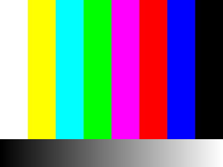

> [中文](gui-cmos.md) | English

# GUI Output and CMOS Emulation: Status, Evidence, and Roadmap

## 1. Conclusion (2026-11-05)

| Capability | Current status | Reason |
| --- | --- | --- |
| GUI / LCD output | 🟡 Host-side scanout/dump is implemented; no firmware-rendered image | Entry segment has `mmio_events=0` and never reached the Display/GPU/GDU |
| CMOS / image input | ❌ None | Same as above; no Sensor/I2C/GDMA access was observed |
| UART log | ❌ Not yet | UART candidate `0x80005010` has not been accessed yet |
| Boot to driver initialization | ❌ Not yet | M0 only proves "the entry function can execute and return"; caller/next stage not found |

The GUI "pipeline" already works: configurable framebuffer window → halt/periodic PPM dump → PNG.
But it has not solved "what the firmware draws", because the firmware has not yet reached the Display/GPU driver. See §3.2.

It is not that "the model cannot be written", but that **there is not yet evidence to decide what the model looks like**. The principle of this project is:
do not guess unknown registers, and do not return "plausible-looking" values; first obtain the real access sequence, then implement.
The catch-all in `qemu.log` is prepared for exactly this step.

## 2. Evidence in the image: the software paths do exist

File offset `0x12AD3C0..0x12AD510` of `b1010_115a.bin` is a **driver/service name string table**:

```
GDMA | I2C | ADC | CEC | HDMI | KRCOM | CGN | GPIO | SIO | DSP |
STAR | TIMER | NOR | I2S | UART | GDU | GPU |
DriverCreate End | DriverInitialize End | DriverStart End |
FrontEnd | Storage | Kr | Sensor | ImageProcess |
DriverCreate Start | DriverInitialize Start | DriverStart Start |
Display | ApplCreate End | ApplInitialize End | ApplStart End |
NetCService | WmaService
```

In addition:

- `AxisSensor` is at `0x1BD904` and `0x2AA310` (sensor name/ID strings);
- `CMOS` is at `0x10D939` (nestled among code/data);
- `EVF` is at `0x12A8D93`;
- `HDMI` is at `0x5634`, `0xFA76C8`, `0x126CC6D`, and `0x12AD3EA`.

This shows that the firmware does contain the **Display / GPU / GDU / HDMI** and **Sensor / ImageProcess /
GDMA / I2C** drivers/services, as well as staged initialization log strings. But:

- No absolute pointers to these names were found (they are mostly PC-relative references), so **no driver table or
  register base addresses were obtained directly**;
- This execution segment did not access any MMIO, not even the UART;
- Therefore there is no framebuffer address, pixel format, stride, sensor ID, DMA descriptor, or interrupt number.

## 3. GUI output roadmap

### G0 — First reach the Display driver

Prerequisite: find the caller/next stage of `0x9027D52C` (see the next steps in `docs/validation.md`).
Once reached, catch-all will record the first batch of `0x80xxxxxx` accesses; those are the Display/GPU/GDU candidates.

### G1 — Determine the rendering path

Two possibilities, whose effort differs by an order of magnitude:

1. **CPU draws directly to the framebuffer**: the firmware writes pixels into RAM, and the Display controller only handles scanout.
   In this case G2 is quick: find the base address/format/stride, and the QEMU side only needs to do scanout.
2. **GPU command stream**: the CPU submits commands to the GPU/GDU, and the GPU composes. Z7 follows this path;
   `nikon-z7-gpu.h` implements a SMAPH-F/OpenVG subset (paths, strokes, bitmaps, alpha).
   If D750 is isomorphic, a subset must be built from the real command stream, with effort measured in weeks.

Criterion: look at whether catch-all shows "RAM writes + one scanout register" or "batched command/descriptor
writes + completion interrupt".

### G2 — Scanout

Add a `d750-lcd` device in the machine (or reuse a RAM window):

- Configurable `lcd-base`, `lcd-width`, `lcd-height`, `lcd-stride`, `lcd-format`
  (RGB565/ARGB8888/RGB888);
- Dump the framebuffer to PPM/PNG periodically or on demand, for inspection in a headless environment;
- If interaction is needed, follow z7's route: QEMU display surface + QMP `screendump` + browser.

Acceptance is not "there is an image", but: **the firmware's own UI elements appear in the image** (text, icons, menus),
and it is possible to explain which framebuffer/GPU command they came from.

### G2 status (implemented parts)

Machine properties (`-M nikon-d750,...`):

| Property | Default | Description |
| --- | --- | --- |
| `lcd-base` | `0` (disabled) | Guest physical framebuffer base address |
| `lcd-width` / `lcd-height` | 640 / 480 | Pixel dimensions |
| `lcd-stride` | 0 | 0 = width × bpp |
| `lcd-format` | `argb8888` | Also supports `rgb888` and `rgb565` |
| `lcd-out` | `lcd.ppm` | PPM output path |

Behavior:

- On every halt (entry return) and every 2 seconds, dump the window as a P6 PPM;
- The window must fall entirely within `0x90000000 + ram_size`; otherwise only log entries are written and no file is produced;
- With `lcd-base=0`, there is zero overhead and no file is produced.

Verified by writing a 320×240 test card to `0x92000000` with GDB:

```
d750-lcd: dumped 320x240 (argb8888, stride 1280) from 0x92000000 to /tmp/lcd.ppm
```



This image is a **host-written test card**, proving that "guest RAM → scan → PPM/PNG" works;
it is **not** the firmware UI. The real firmware does not write the framebuffer, so the default run produces a black image.

### G3 — Input and refresh

Button/dial injection, menu switching, and LCD refresh throttling; these are z7's `interactive.py`-level work,
to be done only after G1/G2 are stable.

## 4. CMOS emulation roadmap

### C0 — First reach the Sensor/I2C driver

This likewise assumes M1. The first batch of accesses may land on the I2C controller or sensor
control block at `0x80xxxxxx`; catch-all will provide the address, width, and direction.

### C1 — Sensor control plane

Questions to answer:

- Is the sensor attached to I2C, or proxied by an independent MCU?
- What is the ID register that the host reads? What value must be returned for the driver to continue?
- The minimal set of power-on sequencing, reset, clock, and gain/exposure registers.

At this layer, a CMOS model is usually a **register stub + synthetic ID/state**, rather than a complete sensor.

### C2 — Data plane

The descriptor/interrupt contract needs to be established:

- Frame geometry, bit depth (12/14-bit), Bayer layout, and stride;
- GDMA/GDU descriptor format, destination buffer, and completion interrupt/status bits;
- Whether live view and still capture use different paths.

Before these are obtained, "putting an image into RAM" will not make the firmware consume it.

### C3 — Functional ISP (optional)

Z7's approach is: synthesize RGGB u16 → write according to the firmware's DMA descriptors → functional ISP (demosaic,
tone, NV12) → write back to the output buffer submitted by the firmware → scan out via the LCD. Nikon's real ISP algorithms
are not implemented, and no claim is made to implement them.

If D750 only needs "there is an image", the minimal C1+C2 loop can be done first; only for a "photo-like image" is
C3 needed, and it must be stated clearly that this is a **functional approximation**, not Nikon's algorithms.

## 5. Gap versus z7-qemu / z9-qemu

| Capability | Z7 | Z9 | D750 (current) |
| --- | --- | --- | --- |
| Boot | Known MAIN entry + assisted call | Known entry + external peer | Only reaches return from the init function |
| GUI | GPU subset + LCD scanout + browser | GPU + LCD + browser | None |
| CMOS | Synthetic RGGB + RAW DMA + ISP | NV12/NV16 + virtual NVMe | None |
| Evidence | 107 instruction checks/16 QEMU checks, etc. | Full still/video acceptance | M0 (entry executes and returns) |

The root cause of the gap is not that QEMU devices cannot be written, but that **D750's boot chain and register contract have not yet been observed**.
Z7/Z9 addresses, IRQs, and protocols cannot be reused on the grounds that they are all EXPEED; this is also explicitly written in their
`docs/research-notes.md`.

## 6. What can be done now

In priority order:

1. **Find the next boot stage** (recommended; prerequisite for all GUI/CMOS work):
   - Find the descriptor table consumers/ROM handoff conventions in the image;
   - Use `-machine entry=` to verify candidate entries one by one;
   - Use `--strict` to catch the first unmodeled access (`d750-strict:` log, `run.py` exit code 7).
2. **LCD dump hook (completed)**:
   - `lcd-base/width/height/stride/format/out` are configurable;
   - Dump PPM on halt and every 2 seconds; disabled when `lcd-base=0`;
   - The pipeline has been verified with a test card; it can be used directly once G1 obtains the real base address/format.
3. **CMOS test frame fixture** (likewise without guessing the contract):
   - Load a raw RGGB frame from a file and preset it into RAM;
   - After C2's descriptors are determined, have the GDMA model move it into the firmware buffer;
   - While the contract is unknown, use it only as a "data source", not pretending to be a sensor.

## 7. Acceptance criteria (avoid treating "there is output" as "emulation succeeded")

- GUI: the image contains firmware-rendered UI elements; it is possible to point to the source of the framebuffer/command stream; it is not a host-pasted image.
- CMOS: the firmware **consumes** the frame (DMA completion, ISP output, live view update), not merely
  "there is an image in RAM".
- Both must record: addresses, formats, interrupts, counters, and which are assumptions and which are observations.

## 8. References

- Z7's RAW/ISP/LCD path: <https://github.com/WonderLantern/z7-qemu>
  ("RAW and functional ISP" and "GPU and LCD" in `docs/architecture.md`)
- Z9's NV12/NV16, virtual NVMe, and capture loop: <https://github.com/WonderLantern/z9-qemu>
- This project's current M0 evidence: `docs/validation.md`, `docs/findings.md` §11
